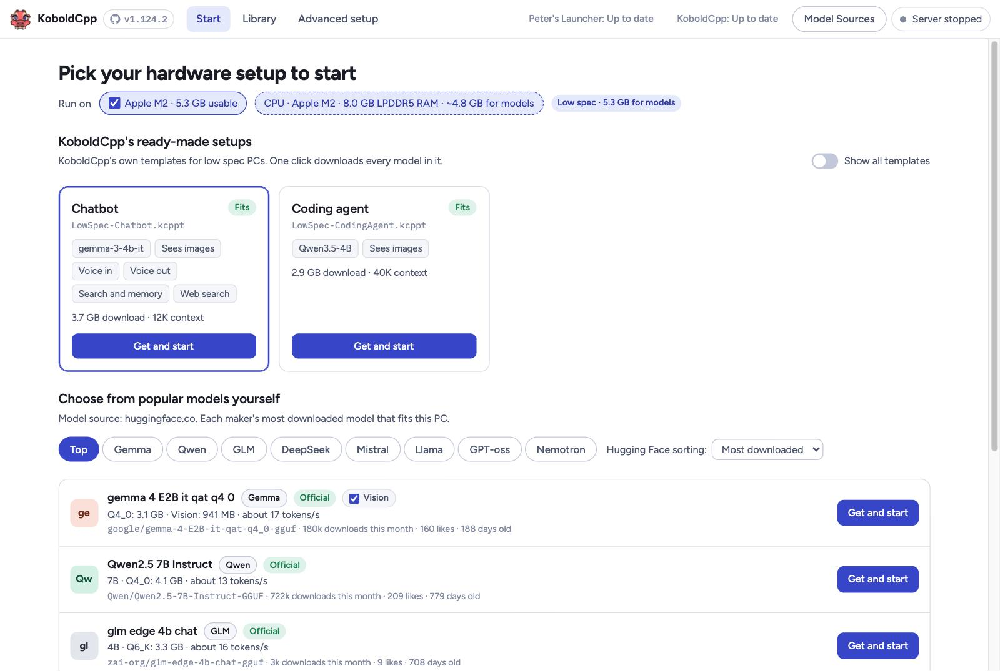
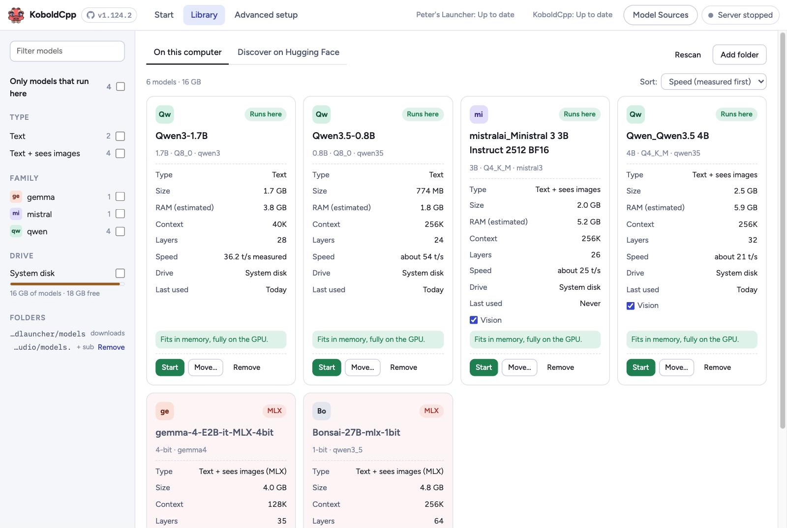
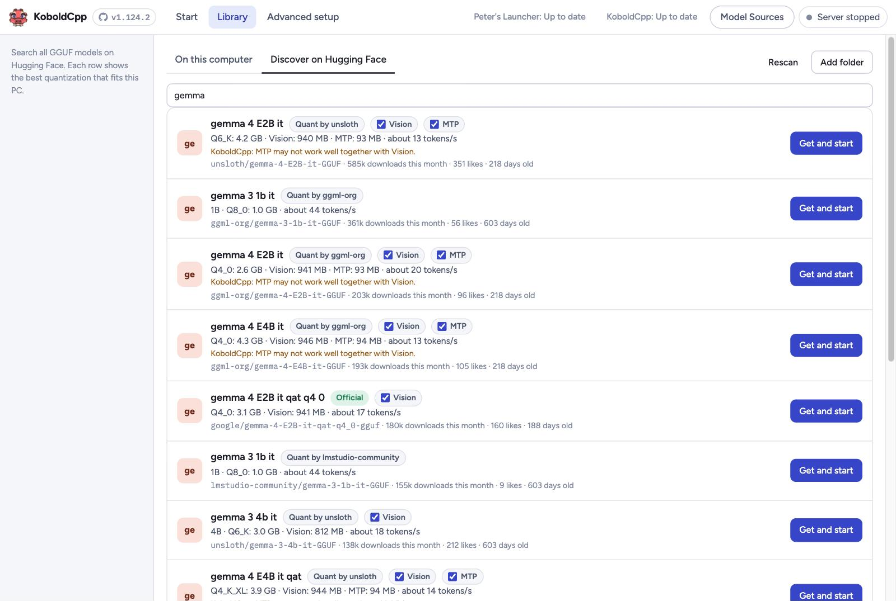
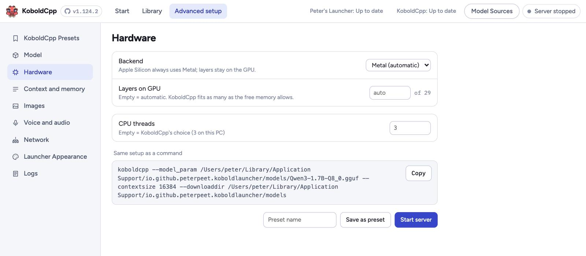
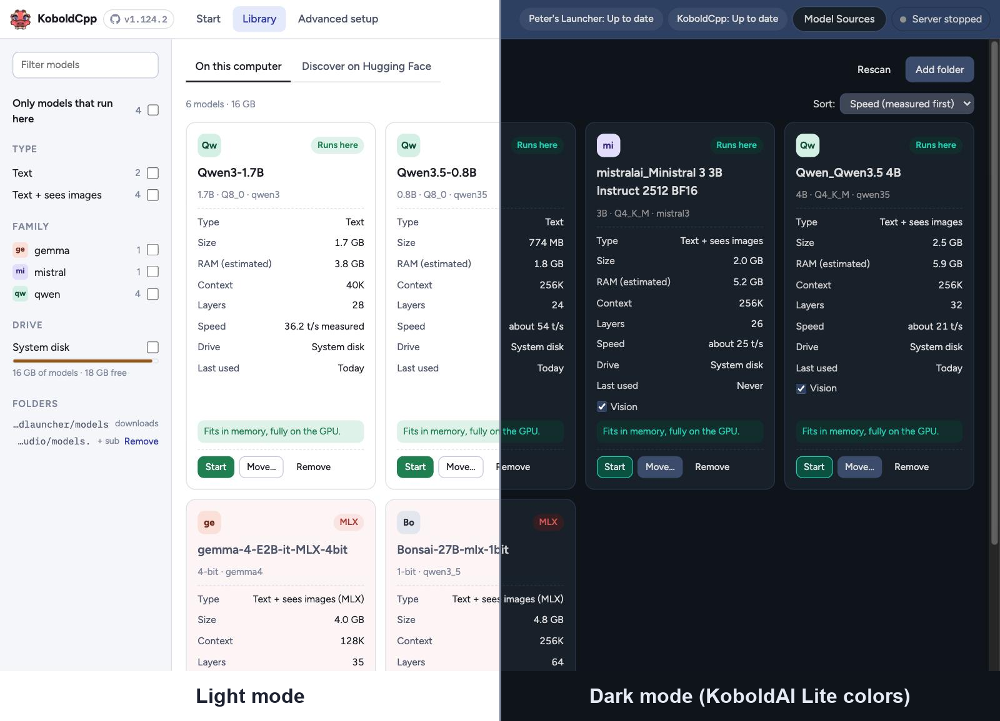

# KoboldCpp Peter's Launcher

A modern desktop launcher for [KoboldCpp](https://github.com/LostRuins/koboldcpp), written in Rust
with Tauri. It replaces the Tkinter starter: it looks at your PC, finds models that fit, downloads
them, writes a `.kcpps` settings file and starts the official KoboldCpp program. KoboldCpp itself and
its web UI (KoboldAI Lite) stay unchanged.

**For whom:** anyone who wants to chat with a local AI model without learning what Q4_K_M, GPU
layers or context size mean, and anyone who knows exactly what they mean and wants every KoboldCpp
option in one place.



## Download

Get the installer for your system from [Releases](https://github.com/PeterPeet/KoboldCpp-Launcher/releases):
macOS (Apple Silicon), Windows and Linux (x86_64 and arm64). On first start the launcher installs the
matching official KoboldCpp release for you.

The installers are not signed with an Apple or Microsoft certificate yet, so the system asks once:

- **macOS:** drag the app to Applications and open it. When macOS says it can't verify the
  developer, click **Done**, then open **System Settings › Privacy & Security**, scroll down and
  click **Open Anyway** next to "KoboldCpp Launcher", and confirm. After that it opens normally.
- **Windows:** in the SmartScreen warning, click **More info › Run anyway**.

## What it does

### Start in one click
The start screen detects your GPUs, CPU and memory (type and bandwidth, e.g. "8.0 GB LPDDR5 RAM").
It shows KoboldCpp's own ready-made setups for your class of PC, and a list of popular models
from Hugging Face. Each list shows only what fits.

- **Get and start** downloads everything needed and starts KoboldCpp. A model already on disk
  gets a green **Start** button instead.
- The best quantization that fits is picked for you. Each row shows its size, the vision file if
  ticked, and the expected speed ("Q4_0: 3.1 GB · Vision: 941 MB · about 17 tokens/s").
- **Top** shows each maker's most downloaded model (Google, Qwen, Z.ai, DeepSeek, Mistral AI,
  Meta, OpenAI, NVIDIA). The family buttons list all models of one family. Hugging Face sorting:
  most downloaded, trending, most liked or newest.
- **Vision** and **MTP** (faster answers through multi-token prediction) can be switched per
  model. Both are on by default, and your choice is remembered. MTP is either built into the
  model file (Qwen 3.5 and newer) or a small extra file the launcher downloads (Gemma 4, e.g.
  "MTP: 93 MB").
- Speeds are estimated from your memory bandwidth. After a model has run, the speed KoboldCpp
  measured is shown instead. When a value can't be known, it says N/A rather than guessing.

### Your model library


Every `.gguf` in your folders becomes a card: type, size, estimated RAM, context, layers, speed,
drive and last use. The card also says whether the model runs here and why not (missing parts,
unknown architecture, not enough memory, or an MLX model, which belongs in LM Studio).

- Add any folder, optionally with all subfolders, such as LM Studio's `~/.lmstudio/models`.
- Filter by type, family and drive. Sort by measured speed, last use, name or size.
- Move a model to another folder or drive, or remove it to the Trash.

### Discover on Hugging Face


Search the GGUF models of your active sources on Hugging Face (a note says how many matches came
from sources that are off). Results look and work like the popular list: labels
("Official" for the maker's own upload, "Quant by …" for others), the quantization that fits,
Vision and MTP options, and Get and start.

### Every KoboldCpp option


Advanced setup groups KoboldCpp's options into pages:

- KoboldCpp Presets
- Model
- Hardware (backend, GPU layers, split across several GPUs with memory bars)
- Context and memory
- Images
- Voice and audio
- Network
- Launcher Appearance
- Logs

The matching command line is always shown and can be copied. Presets are saved as `.kcpps`
files, and any `.kcpps` or `.kcppt` can be imported.

### Light and dark


Choose Light, or KoboldAI Lite's own default colors, under Advanced setup › Launcher Appearance.

### And also
- **Esobold mode** (Advanced setup › Esobold ⚠️): switches the launcher to
  [Esobold](https://github.com/esolithe/esobold), a community fork of KoboldCpp with Esolite.
  You unlock it by typing a phrase; it brings its own colors and icon, offers Esobold's own
  options (tool calls, file endpoints, the OpenLumara agent), and KoboldCpp stays installed next
  to it.
- **Model Sources:** which Hugging Face accounts feed the lists. The makers are built in; unsloth,
  bartowski, TheDrummer or anyone else can be added. Sources are kept in priority order and can be
  exported and imported as a file.
- **Updates:** the top bar shows "Peter's Launcher: Up to date" and "KoboldCpp: Up to date".
  KoboldCpp updates install in place, after a SHA-256 check, and a running model is restarted.
  A new launcher version opens its release page.
- **Open Lite:** while a model runs, one click opens KoboldAI Lite in your browser.
- **Clean shutdown:** closing the launcher stops the KoboldCpp it started. A KoboldCpp left over
  from a launcher that was killed is ended at the next start.

*Screenshots: an Apple M2 with 8 GB, real data from Hugging Face and a real model library.*

## Where files live

Everything goes into the app data folder (on macOS
`~/Library/Application Support/io.github.peterpeet.koboldlauncher/`):

| Path | Content |
|---|---|
| `settings.json` | launcher settings and sources |
| `bin/<version>/` | the KoboldCpp program |
| `models/` | downloaded models (default; more folders can be added in the library) |
| `presets/*.kcpps` | saved presets |
| `runs/last-run.kcpps` | settings of the last start |
| `logs/koboldcpp.log` | everything KoboldCpp printed during the last start |
| `logs/launcher.log` | what the launcher did: starts, stops, downloads, updates, errors |
| `cache/` | Hugging Face answers (24 h) |

## Development

Tauri 2 app: Rust in `src-tauri/`, TypeScript + Vite in `src/`.
Design notes: [docs/DESIGN-NOTES.md](docs/DESIGN-NOTES.md).

Prerequisites: Rust via [rustup](https://rustup.rs), Node.js 20+, Xcode (macOS).

```bash
npm install
npm run tauri dev     # run the app with hot reload
npm run tauri build   # build a release bundle
```

Opened in a normal browser (`npm run dev`), the UI runs on example data and shows a
"Browser preview" badge.

Tests:

```bash
cd src-tauri
cargo test                                    # unit and integration tests, offline
cargo test --test hf_live -- --ignored        # live Hugging Face checks
KL_E2E_DIR=/tmp/kl-e2e cargo test --test e2e -- --ignored --nocapture
```

The last one downloads the real KoboldCpp release and a 0.4 GB model, starts it, checks its API and
stops it. `KL_CA_BUNDLE=/path/to/bundle.pem` makes all downloads trust only that certificate bundle
(for corporate proxies or sandboxes without keychain access).

When KoboldCpp adds launch options or model architectures, refresh the tables from its source:

```bash
python3 -I tools/extract_args.py path/to/koboldcpp.py v1.xxx > src-tauri/src/config/args.json
python3 -I tools/extract_archs.py path/to/src/llama-arch.cpp v1.xxx > src-tauri/src/config/archs.json
python3 -I tools/extract_args.py path/to/esobold/koboldcpp.py esobold@<commit> > src-tauri/src/config/args-esobold.json
```

### Screenshots

The README pictures show real data. A hidden test records what the real commands answer on your
computer, and the browser preview then shows those answers instead of its example data:

```bash
cd src-tauri && cargo test --test screenshot_data -- --ignored --nocapture
```

Then open `http://localhost:1420/?fixture#start` (add `&theme=lite` for the dark colors) while
`npm run dev` runs. The recording goes to `shots-data/`, which is git-ignored because it contains
local paths.

### Releases

Pushing a version tag builds the installers for all platforms with GitHub Actions
(`.github/workflows/release.yml`) and attaches them to a draft release. GitHub adds the source code
as zip and tar.gz automatically.

```bash
git tag v0.1.0 && git push origin v0.1.0
```

License: AGPL-3.0, same as KoboldCpp.
